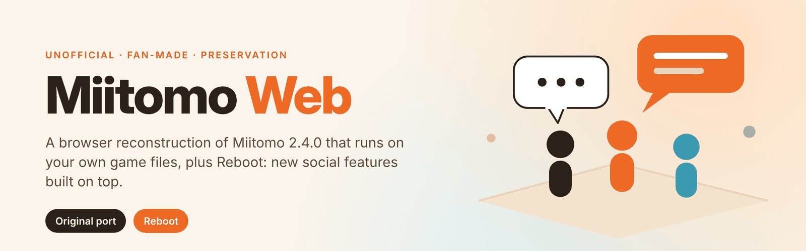
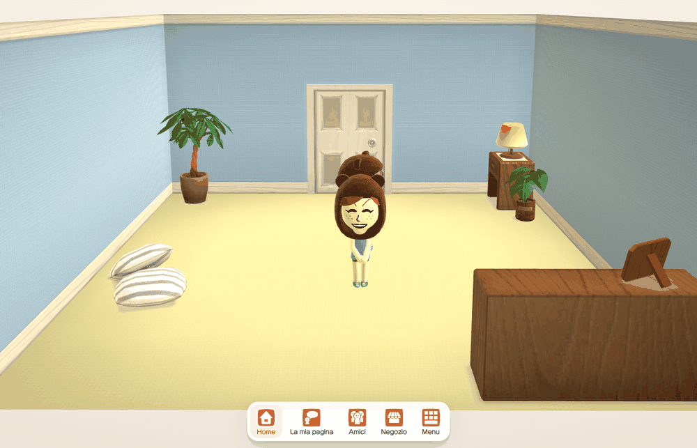
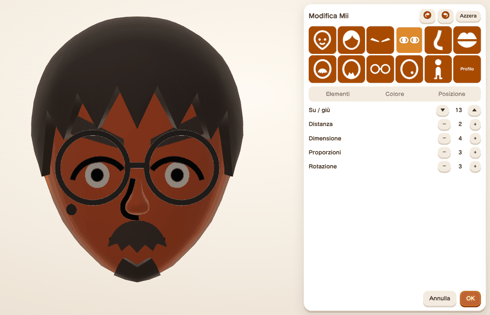
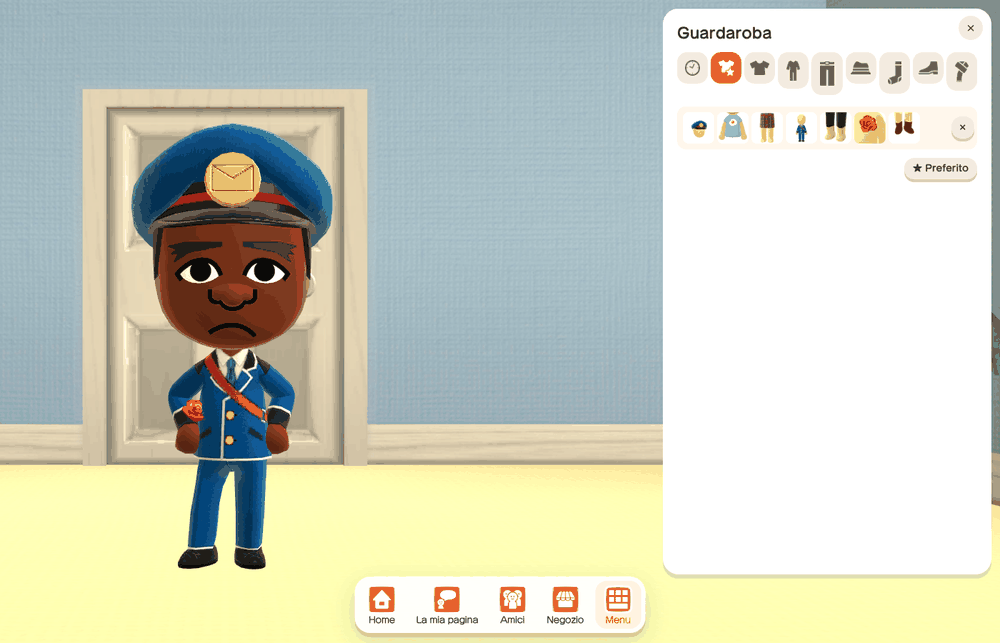
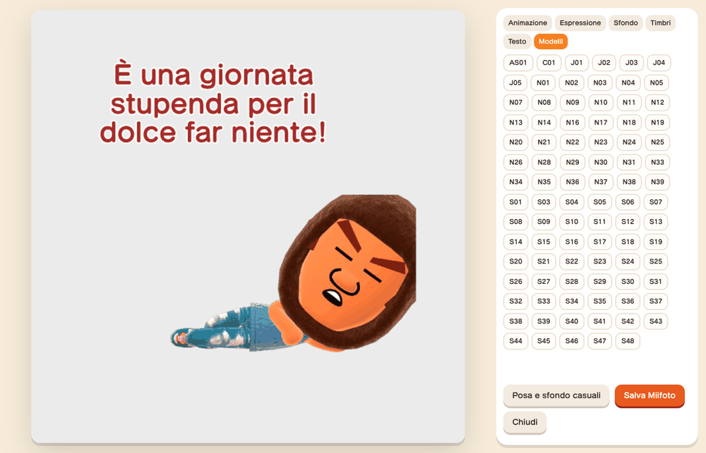
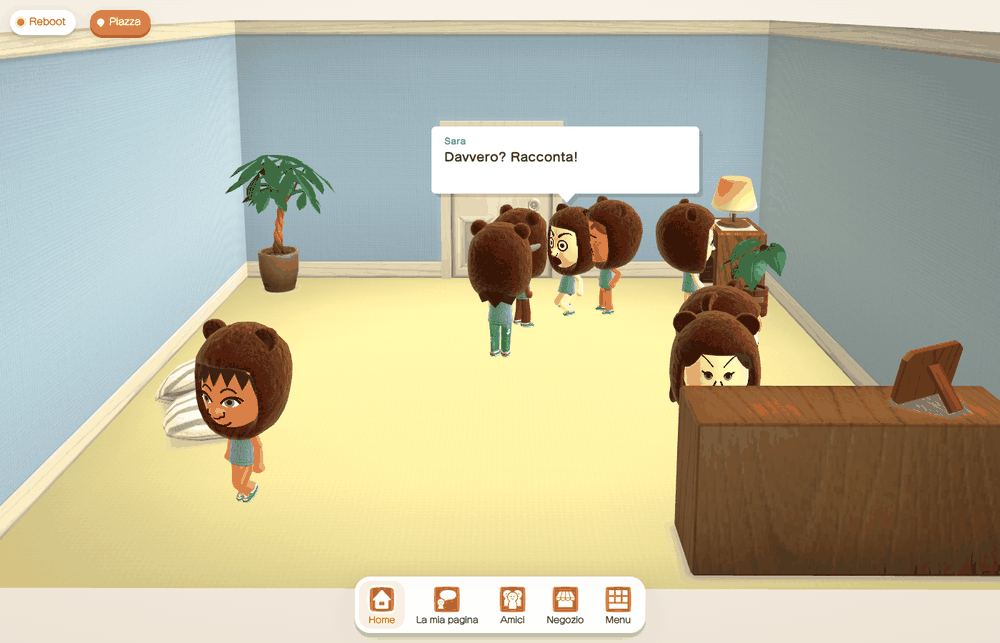
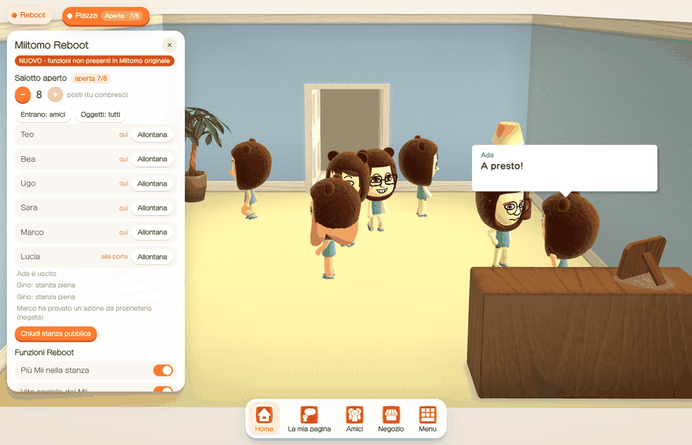
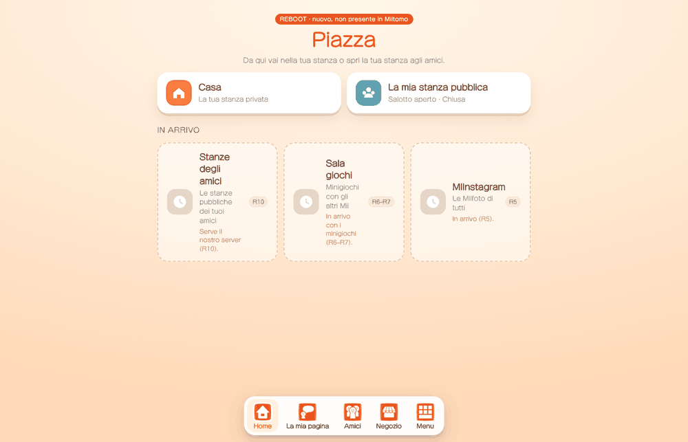
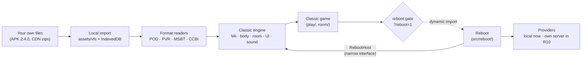

<p align="center">
  
</p>

<p align="center">
  <a href="https://github.com/FrySco19/miitomo-web/actions/workflows/ci.yml"></a>
  
  
</p>

**Miitomo Web** is an unofficial, fan-made reconstruction of Nintendo's *Miitomo* (Android 2.4.0) that runs in a
desktop browser. It does not ship any Nintendo content: the game reads the models, textures, texts and sounds from
**your own copy** of the original files at runtime.

The repository holds two clearly separated experiences:

| | **Miitomo Web (Classic)** | **Miitomo Reboot** |
|---|---|---|
| Goal | Rebuild Miitomo 2.4.0 as it was, from evidence | Add new social features on top of the Classic engine |
| Content | Only what exists in the original files; missing server content stays marked as missing | New features, clearly labelled as not original |
| Start | `avvia-miitomo-web.bat` or `?reboot=0` | `avvia-miitomo-reboot.bat` or `?reboot=1` |
| Status | Playable core loop; see [ORIGINAL-PORT-STATUS](docs/ORIGINAL-PORT-STATUS.md) | Phases R1–R4 done, R5 next; see [ROADMAP](docs/reboot/ROADMAP.md) |

**▶ Web preview: [frysco19.github.io/miitomo-web](https://frysco19.github.io/miitomo-web/)**. It hosts the code only:
on the first visit you import your own Miitomo files, which stay in your browser for the next visits. Add
`?reboot=1` to the address to open Reboot.

> [!IMPORTANT]
> This is a preservation and research project. It is **not affiliated with, endorsed by or connected to Nintendo**.
> It never contacts Nintendo servers, has no online play and no real-money purchases.

## Screenshots

All screenshots are real captures of the current build, taken by the automated end-to-end tests in headless
Chromium. The Mii, room, clothing and interface graphics in them come from the original game files supplied
locally; they are shown for documentation only and are not part of this repository's licence.

| Classic: the room | Classic: Mii editor |
|---|---|
|  |  |
| **Classic: wardrobe** | **Classic: Miifoto** |
|  |  |
| **Reboot: eight Miis talking** | **Reboot: public room** |
|  |  |
| **Reboot: the "Piazza" hub** | |
|  | |

## Features

### Miitomo Web (Classic)

- Miis rendered from the original AFL resource through [FFL.js](https://github.com/ariankordi/FFL.js), with the
  original APK shader, body proportions reversed from the binary, and the 138 original gesture clips.
- The room: original models, door, camera, state machine, objects, sounds, music and Italian texts.
- Talking: original faces and gestures chosen by the game's own rules and word lists; particle effects.
- First-run flow, Mii Studio editor, personality results, greetings.
- Wardrobe with the original tabs; shop catalogue with try-on (no economy); Miifoto editor with PNG export.
- Local friends: visit a friend's room, or have one friend visit yours.
- Local save with export and import.

Every element is classified as ORIGINAL, REVERSED, DEDUCED, APPROXIMATED, SERVER DATA MISSING or WEB ADAPTATION in
[`docs/CLASSIFICATION.md`](docs/CLASSIFICATION.md). The question database, friends' answers, coins and ranks were
server data that no longer exists; they are shown as missing, never invented.

### Miitomo Reboot (new, not in the original game)

| Phase | Feature | State |
|---|---|---|
| R1 | Separation from Classic, feature flags, server contracts, safety primitives | done |
| R2 | Up to 8 Miis in the same room, shared door queue, personal distance | done |
| R2b | Social life: Miis notice each other, hold conversations, choose activities by personality | done |
| R3 | Public room: open your room to visitors, permissions, kick, polite closing | done |
| R4 | Social hub "Piazza": move between your room and your public room | done |
| R5 | MIInstagram and Miifoto 2 | next |
| R6–R12 | Minigames, events, rewards, notifications, own backend, realtime multiplayer, polish | planned |

Reboot is local only today. Visitors in the public room are simulated by a local service that emits the same events
the planned backend will send.

## Architecture



- **Classic never loads Reboot code.** Reboot is a separate chunk, loaded only when the gate is open, and reaches the
  engine only through the `RebootHost` interface. A unit test enforces the import boundary.
- **No secrets in the browser.** The planned backend uses a server session; the client refuses Nintendo hosts.

See [`docs/reboot/ARCHITECTURE.md`](docs/reboot/ARCHITECTURE.md) and [`docs/architecture/`](docs/architecture/).

## Getting started

### What you need

- Node.js 20 or later, and a desktop browser with WebGL 2. The automated tests use Chromium; other browsers have
  not been tested systematically.
- **Your own copy** of the original files: the Miitomo 2.4.0 APK and the CDN asset zips. This repository does not
  provide them and will not tell you where to download them.

### Build and run

```bash
git clone https://github.com/FrySco19/miitomo-web.git
cd miitomo-web/client/web
npm ci            # also copies the FFL WebAssembly module into public/ffl
npm run dev       # development server on http://localhost:5173
npm run build     # type check + production build into client/web/dist
npm run preview   # serves the build on http://localhost:4173
```

Open the page and import your files with the file picker. Add `?reboot=1` to the address to open Reboot, or
`?reboot=0` to force Classic.

### Windows launchers

After `npm run build`, put your files in the project folder (the APK and the asset zips in the root, other CDN zips
in `local-assets/cdn/`) and double-click:

- `avvia-miitomo-web.bat`: Classic;
- `avvia-miitomo-reboot.bat`: Reboot.

They start `tools/serve-local.ps1`, a small server bound to `localhost` that serves the build and, read-only, only
your own asset files. Nothing leaves your computer.

## Testing

Unit tests that need no game files; these run in CI on every push:

```bash
cd client/web
for t in bodyscale framing personality reboot social rooms hub; do npx tsx ../../tests/unit/$t.test.mts; done
```

End-to-end tests drive the real build in headless Chromium with Playwright. They need your own game files, so they
run locally only:

```bash
(cd tests && npm install --no-save playwright && npx playwright install chromium)
(cd client/web && npm run build && npx vite preview --port 4173) &
node tests/e2e/m18-guest.smoke.mjs http://localhost:4173/ out/m18 <your files…>
```

Each suite lists its arguments in its header comment.

The regression set used for this project is 16 suites: `m8`, `m9`, `m12`–`m18`, `full`, `m13-voice`,
`m13-update`, `r2`, `r2b`, `r3`, `r4`. Older suites (`mii-lab`, `mii-full`, `m6`, `m7`) are kept in the repository but are not part of the current
regression set.

## Project structure

```
client/web/            browser client (Vite + TypeScript + three.js)
  src/formats/         readers for the original file formats
  src/agx/             original shader material
  src/body/ room/ play/ social/ voice/ effects/   Classic engine and game
  src/reboot/          Miitomo Reboot (loaded only behind the gate)
tests/unit/            unit tests (tsx)
tests/e2e/             end-to-end tests (Playwright, need your own files)
tools/                 local server and research scripts (Python, PowerShell)
docs/                  status, classification, reverse engineering, Reboot design
```

## Documentation

Start with the [documentation index](docs/README.md). Key pages:
[original port status](docs/ORIGINAL-PORT-STATUS.md) ·
[classification](docs/CLASSIFICATION.md) ·
[Classic vs Reboot](docs/reboot/CLASSIC-VS-REBOOT.md) ·
[Reboot roadmap](docs/reboot/ROADMAP.md) ·
[play audit](docs/reverse-engineering/AUDIT-PLAY.md).

## Known limitations

- The original Mii voice cannot run in a browser (native ARM engine). The browser's speech synthesis is used
  instead and is labelled as non-original.
- Server-side content is gone: questions and answers, coins, ranks, events, friends' online data.
- Some behaviour is approximated (path planning, timings, some shading and effects); each case is listed in the
  classification.
- Reboot is local only: no accounts, no online play, no real other players yet.
- The room camera is adapted to landscape PC windows; on a phone-shaped window the framing differs from the original.
- Only the Italian text set has been tested.

## Contributing

Contributions are welcome within the project rules: no Nintendo assets, no Nintendo services, no invented original
content. See [CONTRIBUTING.md](CONTRIBUTING.md).

## Legal

Miitomo, Mii and Nintendo are trademarks of Nintendo. This project is an independent, non-commercial fan
reconstruction made for preservation and research. It is not affiliated with, sponsored by or endorsed by Nintendo.

The repository contains only original code and documentation. It does not include the APK, game assets, extracted
files, server credentials or any Nintendo source code. To use it you need files you obtained yourself, under the
terms that apply to you.

## License

The project's own code and documentation are licensed under the
[GNU Affero General Public License v3.0 only](LICENSE) (AGPL-3.0-only), matching the FFL.js dependency. The licence
does not cover Nintendo's files or trademarks, or any graphics from the game shown in the screenshots.
